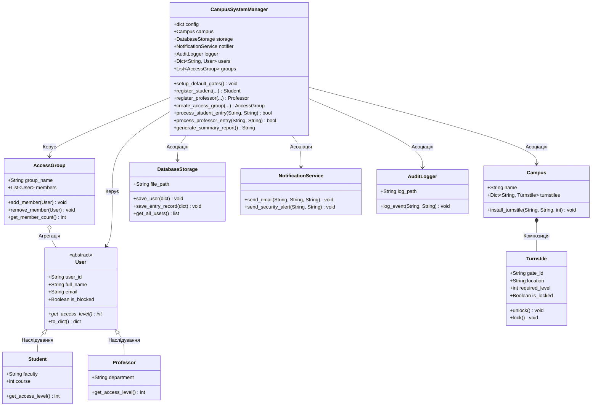
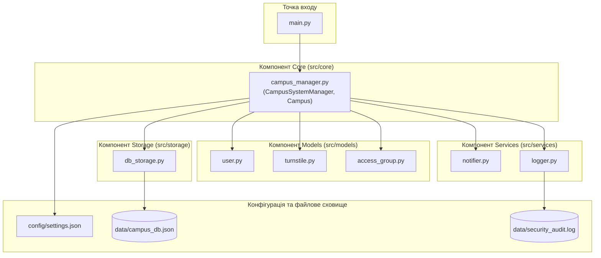

# Лабораторна робота №1
**Тема:** Аналіз структури програмної системи та зворотне проєктування

---

## 1. Загальні відомості про проєкт
* **Назва проєкту:** SmartCampus (Система контролю доступу та управління кампусом)
* **Репозиторій:** [https://github.com/ipzm261lov-glitch/RRPS01](https://github.com/ipzm261lov-glitch/RRPS01)
* **Мова програмування:** Python 3 (використано лише стандартну бібліотеку: `abc`, `json`, `os`, `datetime`, `typing`, `unittest`)
* **Обсяг коду:** ~250 рядків (відповідає вимозі до 5000 рядків)

## 2. Призначення та можливості системи
**Призначення:** автоматизація контролю пропускного режиму на території університетського кампусу, облік користувачів різних ролей та журналювання подій безпеки.

**Основні модулі та можливості:**
* Реєстрація користувачів із різними рівнями доступу (студенти — рівень 1, викладачі — рівень 3).
* Формування груп доступу (наприклад, для учасників заходів або команд).
* Перевірка прав доступу при спробі проходу через турнікети різних корпусів/лабораторій.
* Збереження даних про користувачів та історію проходів у JSON-сховище.
* Відправка сповіщень (email / тривоги безпеки) та запис аудит-логу подій.

---

## 3. Структура каталогів проєкту

```text
RRPS01/
├── config/          # Конфігураційні файли системи (settings.json)
├── data/            # Згенеровані файли бази даних (JSON) та журнали безпеки (.log)
├── src/             # Вихідний код програми
│   ├── core/        # Ядро бізнес-логіки та управління системою
│   ├── models/      # Моделі даних предметної області (користувачі, турнікети, групи)
│   ├── services/    # Допоміжні сервіси (сповіщення, логування)
│   └── storage/     # Шар збереження та читання даних
├── tests/           # Модульні (unit) тести для перевірки логіки доступу
└── main.py          # Головна точка входу для запуску демонстрації
```

---

## 4. Опис основних класів та модулів

| Модуль / Файл | Клас | Роль та короткий опис |
| :--- | :--- | :--- |
| `src/models/user.py` | `User` (ABC) | Абстрактний базовий клас користувача кампусу. Зберігає загальні атрибути (`user_id`, `full_name`, `email`, `is_blocked`) та визначає абстрактний метод `get_access_level()`. |
| `src/models/user.py` | `Student` | Спадкоємець класу `User`. Додає атрибути `faculty` та `course`, повертає базовий рівень доступу `1`. |
| `src/models/user.py` | `Professor` | Спадкоємець класу `User`. Додає атрибут `department`, повертає розширений рівень доступу `3`. |
| `src/models/turnstile.py` | `Turnstile` | Моделює фізичний турнікет на вході. Містить рівень необхідного доступу `required_level` та методи блокування/розблокування (`lock()`, `unlock()`). |
| `src/models/access_group.py` | `AccessGroup` | Групує користувачів для спільного управління. Реалізує агрегацію: об'єкти `User` передаються ззовні та існують незалежно від групи. |
| `src/storage/db_storage.py` | `DatabaseStorage` | Відповідає за ініціалізацію, читання та запис даних користувачів і логів проходу у локальний JSON-файл. |
| `src/services/notifier.py` | `NotificationService` | Імітує відправку інформаційних листів користувачам та тривожних сповіщень службі безпеки. |
| `src/services/logger.py` | `AuditLogger` | Записує хронологічний журнал подій безпеки у текстовий `.log` файл із мітками часу. |
| `src/core/campus_manager.py` | `Campus` | Представляє кампус як єдину інфраструктуру. Реалізує композицію: самостійно створює та контролює життєвий цикл об'єктів `Turnstile`. |
| `src/core/campus_manager.py` | `CampusSystemManager` | Головний керуючий клас (фасад/контролер), який координує роботу всіх модулів: від читання конфігурації до перевірки проходу й генерації звітів. |

---

## 5. UML-діаграма класів



---

## 6. UML-діаграма компонентів



---

## 7. Аналіз проблемних місць програмної системи та висновки

На основі побудованих UML-діаграм та аналізу вихідного коду виявлено такі архітектурні недоліки:

1. **«Божественний клас» (God Class):**
   * Клас `CampusSystemManager` порушує принцип єдиної відповідальності (**SRP**). На діаграмі класів видно, що він є центральним вузлом, від якого залежать майже всі інші сутності. Він одночасно відповідає за читання JSON-конфігурації, створення інфраструктури, реєстрацію користувачів, бізнес-логіку перевірки доступу, керування турнікетами, виклик сервісів сповіщень/логування та формування звітів.
2. **Надмірні залежності (Tight Coupling):**
   * У конструкторі `__init__` класу `CampusSystemManager` жорстко створюються конкретні екземпляри класів `DatabaseStorage`, `NotificationService` та `AuditLogger` (відсутній патерн *Dependency Injection* та абстракції/інтерфейси). Це ускладнює модульне тестування та заміну сховища (наприклад, перехід з JSON на SQLite/PostgreSQL).
3. **Дублювання функціоналу (порушення принципу DRY):**
   * У `CampusSystemManager` методи `process_student_entry()` та `process_professor_entry()` містять ~90% ідентичного коду, хоча завдяки поліморфізму (`user.get_access_level()`) їх можна об'єднати в один універсальний метод `process_entry(user_id, gate_id)`.
   * Аналогічно, методи `register_student()` та `register_professor()` дублюють кроки збереження, відправки email та логування.
   * У класі `DatabaseStorage` методи `save_user()` та `save_entry_record()` дублюють код відкриття, парсингу та перезапису JSON-файлу.

### Висновки щодо архітектури
* **Сильні сторони:** система має чітке фізичне розділення на каталоги (`models`, `storage`, `services`, `core`), використовує абстракцію та поліморфізм для ролей користувачів (`User`, `Student`, `Professor`), а також коректно застосовує агрегацію (`AccessGroup`) і композицію (`Campus` — `Turnstile`).
* **Слабкі сторони:** надмірна централізація бізнес-логіки в одному керуючому класі (`CampusSystemManager`), жорстка зв'язаність компонентів та дублювання коду при обробці однотипних операцій. Для покращення архітектури доцільно розбити `CampusSystemManager` на окремі сервіси (`UserService`, `AccessControlService`, `ReportService`) та впровадити ін'єкцію залежностей.